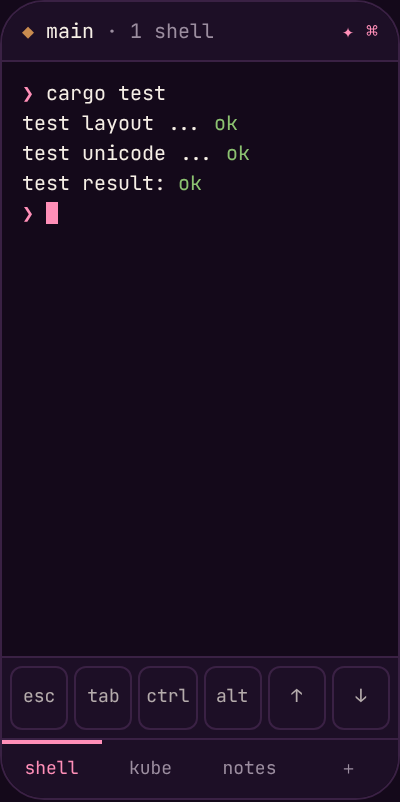

<div align="center">


<br>

[](docs/roadmap.md)
[](#-one-look-on-every-platform)
[](docs/architecture.md)
[](docs/architecture.md)
[](docs/architecture.md#8-rendering-and-input)
[](docs/architecture.md#10-security-model)
[](LICENSE)
[](https://holzcloud.ch/holzwave)
[](https://github.com/sponsors/holzcloud)

**holzWave** is a terminal emulator written from scratch in Rust, for macOS, Windows, Linux, iOS and Android.<br>
Tiled panes, tabs and workspaces, SSH that reconnects, and settings that sync through your own Nextcloud.

**[🌐 holzcloud.ch/holzwave](https://holzcloud.ch/holzwave)**

[Look](#-one-look-on-every-platform) · [Status](#-what-works-today) · [Build](#-build-from-source) · [How it is built](#-how-it-is-built) · [Roadmap](#%EF%B8%8F-roadmap) · [Docs](#-documentation) · [Credits](#-credits)

</div>

---

> [!WARNING]
> ### 🪵 There is no release and no download yet
> holzWave is at `0.0.1-alpha1` and in development. It builds and runs on macOS from source, and it does not yet have
> everything on the list below. The screens in this README are **design mockups**, not screenshots.

> [!IMPORTANT]
> ### 🌊 holzWave is inspired by [Wave Terminal](https://github.com/wavetermdev/waveterm)
> Wave is the UX reference: the shell is one block among others. holzWave started as a fork and is now a separate
> project that **contains none of Wave's code**. It is independent and not affiliated with or endorsed by the Wave
> project. If you want a finished terminal of that kind today, use Wave and consider
> [sponsoring it](https://github.com/sponsors/wavetermdev).

## ✨ Why holzWave?

| | |
|---|---|
| 🪵 **One core, five platforms** | Terminal, layout, connections and sync live in one Rust crate. The platform shells stay thin, so a feature is written once. |
| 🎨 **One look everywhere** | The chrome is drawn by holzWave and uses the same tokens on every platform: flat, mono, hairlines, rose where it matters. |
| ⚡ **Fast by measurement** | A WebGL2 renderer draws a 160×50 grid in about 1 ms, against 4.5 to 7.7 ms for Canvas 2D. The engine parses ~290 MiB/s. |
| 🧱 **Tiled blocks** | Panes, tabs and workspaces with draggable dividers and a layout that survives a restart. Previews and widgets come as blocks later. |
| 🔌 **SSH that reconnects** | Planned: one connection abstraction for the terminal and for file previews, with keychain-only secrets. |
| ☁️ **Your own sync** | Planned: settings, themes, profiles and layouts over WebDAV/Nextcloud, end-to-end encrypted, no server of ours. |
| 🤖 **AI with consent** | Planned: terminal context leaves the device only when you allow that one request. Local models first. |
| 📦 **Few dependencies** | No frontend framework and no bundler. Security-critical code (VT parsing, SSH) comes from established libraries, never hand-rolled. |

## 🖥️ One look on every platform

The same window on five platforms. Only the OS window buttons and the system keyboard differ.

| macOS | Windows |
|---|---|
|  |  |

| Linux | iOS | Android |
|---|---|---|
|  |  |  |

The phone layouts show one pane per screen, the tabs at the bottom and an accessory row (`esc tab ctrl alt ← ↑ ↓ →`)
above the system keyboard. The rules behind the look are in [docs/design.md](docs/design.md).

## ✅ What works today

✅ built and tested on macOS · 🔜 planned, not built

| | Status |
|---|---|
| Local shell in a pane, resize, Unicode with wide characters | ✅ |
| Tiled panes, draggable dividers, tabs, workspaces | ✅ |
| Scrollback, selection, copy, paste | ✅ |
| Layout saved and restored | ✅ |
| WebGL2 renderer with Canvas 2D fallback | ✅ |
| Key encoder, Kitty keyboard, engine replies, themes, dirty-row frames | 🔜 Phase 2 |
| SSH manager, keychain secrets, WSL and Docker | 🔜 Phase 3 |
| Encrypted sync over WebDAV/Nextcloud | 🔜 Phase 4 |
| File browser, Markdown, images, video, PDF, code editor | 🔜 Phase 5 |
| `wsh` CLI | 🔜 Phase 6 |
| Widgets, history search, system monitor, AI chat, Apple on-device AI | 🔜 Phase 7 |
| Kubernetes, Talos, Azure CLI, GAM7 blocks | 🔜 Phase 8 |
| iOS (SSH) and Android (local shell and SSH) | 🔜 Phase 9 |
| Kitty graphics, hyperlinks, signed packages | 🔜 Phase 10 |

Deliberately **not** included: a web browser block.

## 🚀 Build from source

There is no release yet. On macOS (Apple Silicon verified):

```sh
brew install rustup zig@0.16 node
export PATH="/opt/homebrew/opt/zig@0.16/bin:$PATH"   # Zig 0.16.0 exactly; see below
rustup default stable

git clone https://github.com/holzcloud/holzWave
cd holzWave
npm --prefix app ci && npm --prefix app run build    # the frontend, compiled by tsc
cargo run -p holzwave-app                            # builds libghostty-vt with Zig, then starts the app
```

**Why Zig 0.16.0 and not the newest?** `libghostty-vt` is built by Ghostty's own `build.zig`, which needs exactly
Zig 0.16. Zig 0.17 removed an API it uses and fails. The crate is pinned by git revision for the same reason.

Run the tests and the renderer benchmark locally:

```sh
cargo test --workspace
cargo run --release -p holzwave-spike -- throughput 256
```

**Windows and Linux** are written and cross-checked from a Mac, and have **not** been run on their own platform yet:
the build guides are [docs/build-windows.md](docs/build-windows.md) and [docs/build-linux.md](docs/build-linux.md), and the
list the owner runs on their own machines is Part 4 of [docs/test-plan.md](docs/test-plan.md). Do not expect them to work
until that list has passed. Installers are unsigned. iOS and Android are planned and not yet built.

## 🧱 How it is built

| Part | Choice |
|---|---|
| Core | One Rust crate shared by every platform |
| Terminal engine | `libghostty-vt` behind a `TerminalEngine` trait, `alacritty_terminal` as fallback |
| PTY / SSH | `portable-pty` / `russh` |
| App shell | Tauri 3 (alpha) for desktop, iOS and Android |
| UI | TypeScript, no framework, no bundler |
| Rendering | WebGL2 glyph atlas, one instanced draw per pane, Canvas 2D fallback |
| Persistence | JSON today, SQLite for settings and history |

The core owns all state and the webview mirrors it. Details, boundaries and the security model are in
[docs/architecture.md](docs/architecture.md).

## 🗺️ Roadmap

| Phase | What | Status |
|---|---|---|
| 1 | Spike: engine, PTY, renderer decision, baseline | ✅ |
| 2 | Desktop MVP: key encoder, themes, dirty rows, robust panes | 🔨 in progress |
| 3 | Remote: SSH, secret store, WSL/Docker | 🔜 |
| 4 | Sync: encrypted WebDAV/Nextcloud | 🔜 |
| 5 – 6 | Previews and the `wsh` CLI | 🔜 |
| 7 – 8 | Extras and native integrations | 🔜 |
| 9 – 10 | Mobile and polish | 🔜 |

Versions follow `0.0.1-alpha1` → `0.0.1-beta1` → `0.0.1`. Alpha and beta are GitHub prereleases. The full plan is
in [docs/roadmap.md](docs/roadmap.md).

## ⚖️ Where holzWave stands

**Behind today**

- No release, no signing. macOS from source is the only verified platform; Windows and Linux are written and wait for the owner's run (an unsigned installer and packages can be built locally from the guides).
- Tauri 3 and `libghostty-vt` are pre-release; their APIs move and the build pins exact versions.
- The keyboard uses a small table until the engine's key encoder lands (Phase 2).
- A single maintainer, and no CI by design: everything is built and tested locally.

**What it aims to do differently**

- One Rust core for desktop and mobile, so the same layout and sync work on a phone.
- Sync without a server of ours: your Nextcloud, encrypted end to end.
- AI that only sees terminal output when you allow that request.
- Few dependencies, measured performance, and a documented plan that says what is not built.

## 📚 Documentation

| | |
|---|---|
| [Architecture](docs/architecture.md) | Boundaries, concurrency, app protocol, security, quality budget |
| [Design](docs/design.md) | Colour, type, components and the window direction |
| [Build on Windows](docs/build-windows.md), [Build on Linux](docs/build-linux.md) | The owner's build guides, with what was and was not verified |
| [Test plan](docs/test-plan.md) | How to run everything locally and the lists the owner runs on their own hardware |
| [Roadmap](docs/roadmap.md) | Phases and what each one delivers |
| [Sync format](docs/sync.md) | Requirements and open questions, decided before any sync code |

## License

GPL-3.0, see [LICENSE](LICENSE).

## 🙏 Credits

- [Wave Terminal](https://github.com/wavetermdev/waveterm) for the idea and the interaction model, and
  [sponsoring Wave](https://github.com/sponsors/wavetermdev) if you can.
- [Ghostty](https://github.com/ghostty-org/ghostty) for `libghostty-vt`, and
  [libghostty-rs](https://github.com/Uzaaft/libghostty-rs) for the Rust bindings.
- [Plus Jakarta Sans](https://fonts.google.com/specimen/Plus+Jakarta+Sans), [Manrope](https://fonts.google.com/specimen/Manrope)
  and [JetBrains Mono](https://www.jetbrains.com/lp/mono/) (all SIL Open Font License 1.1).

Part of the [holzcloud](https://holzcloud.ch) family: [holzBar](https://github.com/holzcloud/holzBar) ·
[holzkube-manager](https://github.com/holzcloud/holzkube-manager) ·
[holzcloud-cms](https://github.com/holzcloud/holzcloud-cms).
