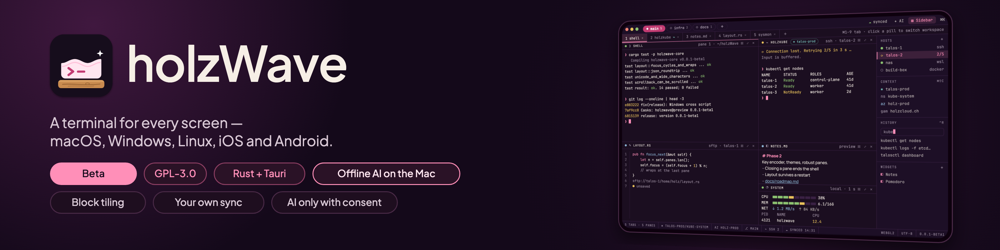
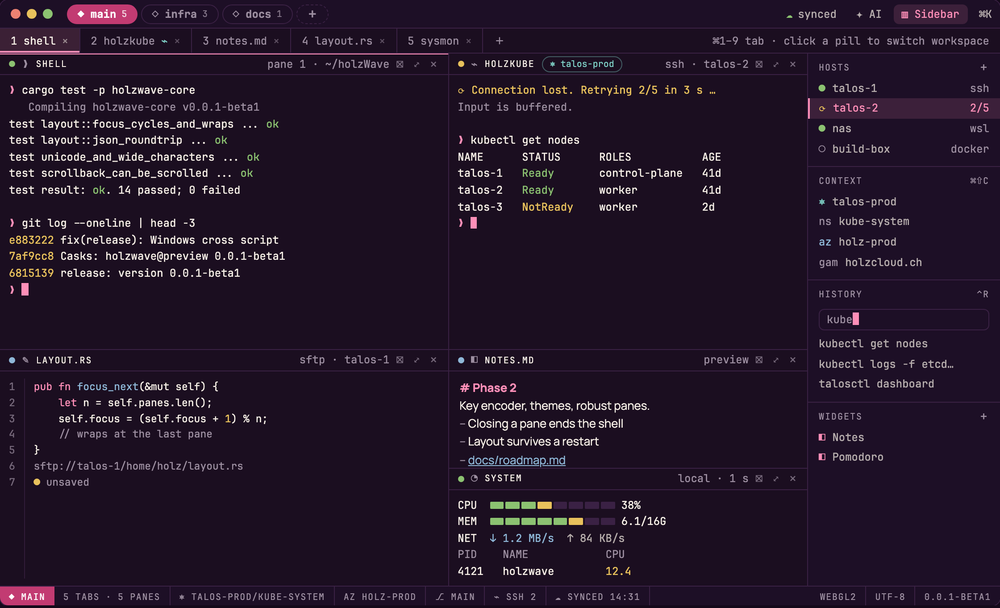
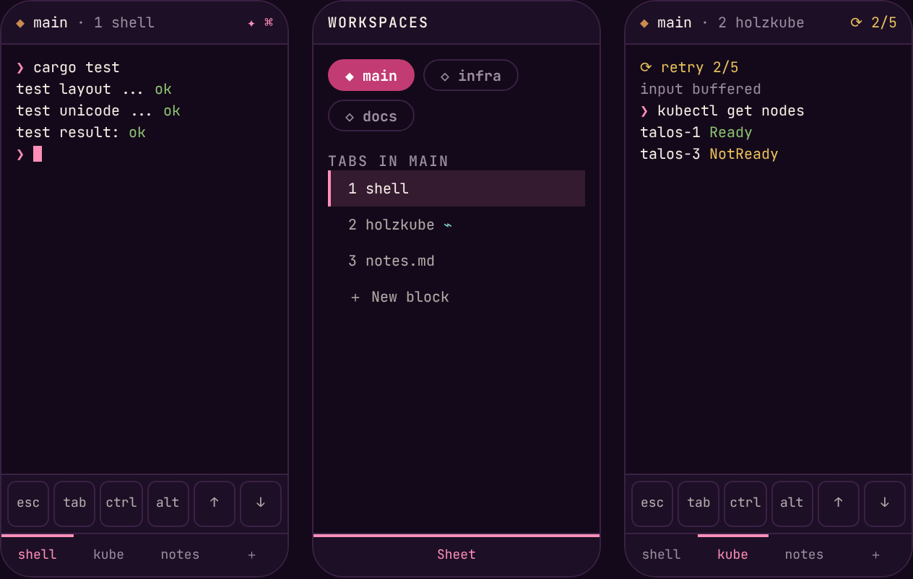
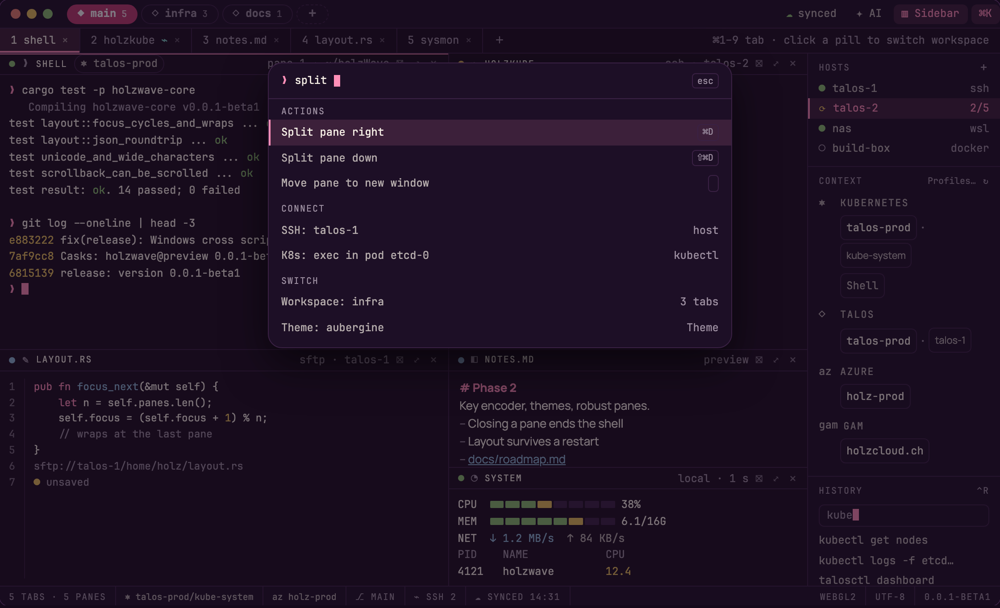
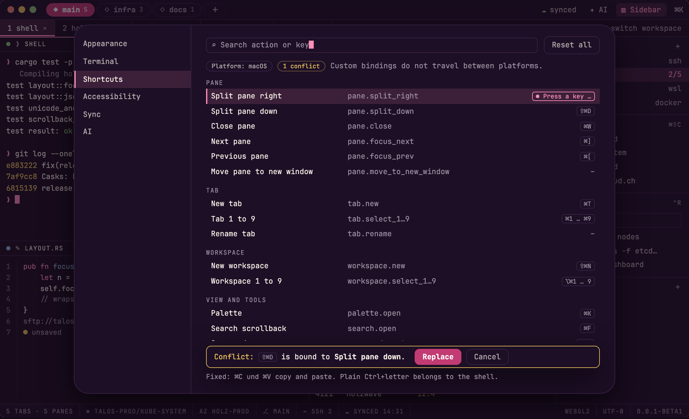
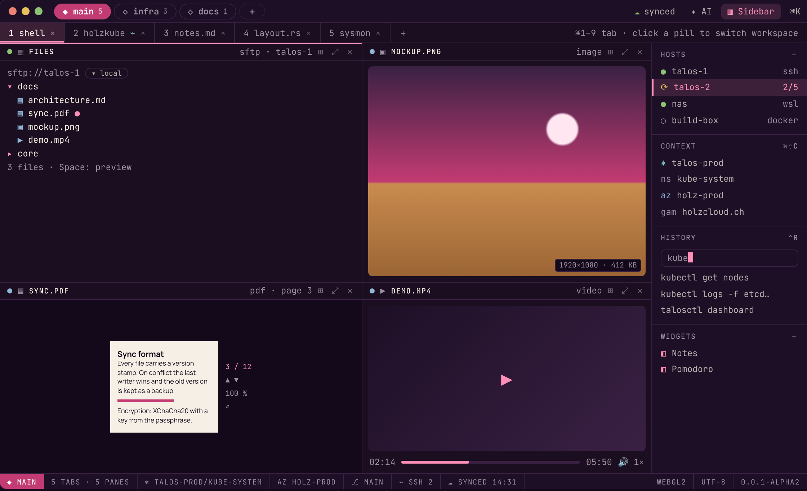
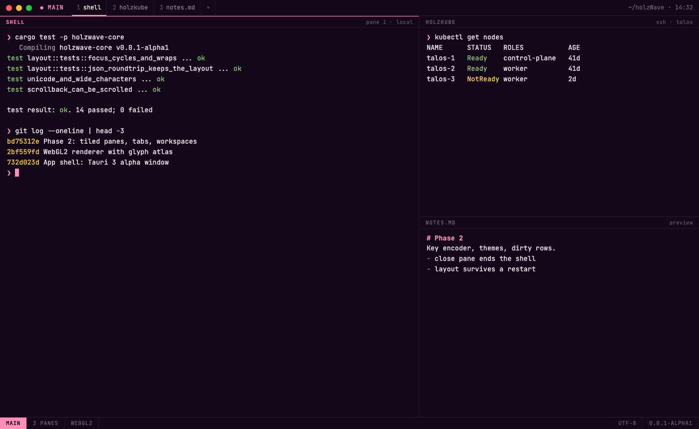
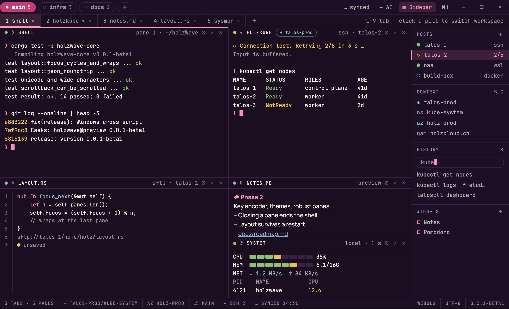
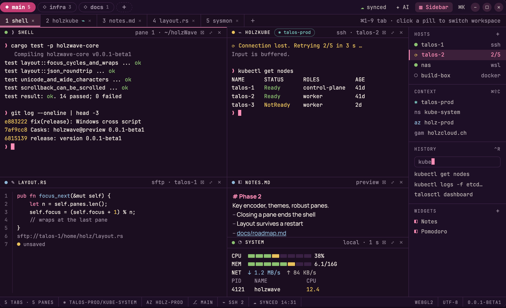

<div align="center">



<br>

[](docs/roadmap.md)
[](LICENSE)
[](docs/architecture.md)

</div>

**holzWave** is an open-source terminal emulator written from scratch in Rust, built on Tauri 3 and
[libghostty](https://github.com/ghostty-org/ghostty). It aims to run on macOS, Windows, Linux, iOS and Android with one
look: tiled panes, tabs and workspaces, a WebGL2 renderer, SSH that reconnects, and settings that sync through your own
Nextcloud. Website: [holzcloud.ch/holzwave](https://holzcloud.ch/holzwave).

> [!WARNING]
> **Alpha, macOS only.** holzWave is at `0.0.1-alpha2`: a preview build for Apple Silicon, unsigned (no Developer ID,
> no notarisation). Windows and Linux builds are written but not yet tested on real machines. The window in the images below is the
> design for the release; the table [What works today](#what-works-today) says what is built.

## Install (macOS, Apple Silicon)

Two Homebrew channels from the casks in this repository:

- **Preview** (`holzwave@preview`): the newest alpha, beta or plain release.
- **Stable** (`holzwave`): the newest plain release, from `0.0.1` on. There is none yet.

```sh
brew tap holzcloud/holzwave https://github.com/holzcloud/holzWave
brew trust --cask holzcloud/holzwave/holzwave@preview
brew install --cask holzcloud/holzwave/holzwave@preview
```

`brew trust` is needed once per cask. Or take the DMG from the [releases](https://github.com/holzcloud/holzWave/releases)
(right-click, Open, once). The cask removes the quarantine attribute so the unsigned app opens.

> [!IMPORTANT]
> holzWave is inspired by [Wave Terminal](https://github.com/wavetermdev/waveterm), whose idea of the shell as one block
> among others is the UX reference. holzWave started as a fork and is now a separate project that **contains none of
> Wave's code**. It is independent and not affiliated with or endorsed by the Wave project. If you want a finished
> terminal of that kind today, use Wave and consider [sponsoring it](https://github.com/sponsors/wavetermdev).

## Design

| Workspaces, tabs and tiled panes | Phone: one pane per screen |
|---|---|
|  |  |

| Command palette | Shortcuts | Previews |
|---|---|---|
|  |  |  |

| macOS | Windows | Linux |
|---|---|---|
|  |  |  |

The same window is drawn on every platform; only the OS window buttons and the keyboard shortcuts differ. All views and
the design rules are in [docs/design.md](docs/design.md).

## What works today

Built and tested on macOS from source:

| Feature | Status |
|---|---|
| Local shell in a pane, resize, wide Unicode | built |
| Tiled panes with draggable dividers, tabs, workspaces | built |
| Scrollback, selection, copy, paste | built |
| Layout saved and restored | built |
| WebGL2 renderer with Canvas 2D fallback | built |
| SSH (reconnect, jump host, keychain), WSL and Docker panes, connection manager | built, tested against a test server, not yet against real hosts |
| File browser, previews (Markdown, text, image, video, audio, PDF) and code editor, local and over SFTP | built, tested against a test server, not yet against real hosts |
| Nextcloud/WebDAV sync, `wsh` CLI | planned |
| iOS, Android, Windows, Linux | planned |

Per-phase detail: [docs/status.md](docs/status.md).

## Build from source

macOS on Apple Silicon is the only verified platform. You need Rust, Node and **Zig 0.16.0 exactly**, because
`libghostty-vt` does not build with Zig 0.17.

```sh
brew install rustup zig@0.16 node
export PATH="/opt/homebrew/opt/zig@0.16/bin:$PATH"
git clone https://github.com/holzcloud/holzwave && cd holzwave
npm --prefix app ci && npm --prefix app run build
cargo run -p holzwave-app
```

More in [docs/building.md](docs/building.md).

## Roadmap

Phase 1 (spike) is done, phase 2 (desktop MVP) is built and waits for its manual checks, and phase 3 (SSH, WSL, Docker,
connection manager) and phase 4 (file browser and previews) are built and tested against a test server. Encrypted
Nextcloud sync and the `wsh` CLI
follow, then mobile. Versions go `0.0.1-alpha2`, `0.0.1-beta1`, `0.0.1`.
Full plan: [docs/roadmap.md](docs/roadmap.md).

## Documentation

[Architecture](docs/architecture.md) · [Design](docs/design.md) · [Roadmap](docs/roadmap.md) ·
[Status and stack](docs/status.md) · [Building](docs/building.md) · [Sync format](docs/sync.md)

## License and credits

GPL-3.0, see [LICENSE](LICENSE).

- [Wave Terminal](https://github.com/wavetermdev/waveterm) for the idea and the interaction model. Please consider
  [sponsoring Wave](https://github.com/sponsors/wavetermdev).
- [Ghostty](https://github.com/ghostty-org/ghostty) for `libghostty-vt`, and
  [libghostty-rs](https://github.com/Uzaaft/libghostty-rs) for the Rust bindings.
- [Plus Jakarta Sans](https://fonts.google.com/specimen/Plus+Jakarta+Sans), [Manrope](https://fonts.google.com/specimen/Manrope)
  and [JetBrains Mono](https://www.jetbrains.com/lp/mono/) (SIL Open Font License 1.1).

Part of the [holzcloud](https://holzcloud.ch) family: [holzBar](https://github.com/holzcloud/holzBar) ·
[holzkube-manager](https://github.com/holzcloud/holzkube-manager) ·
[holzcloud-cms](https://github.com/holzcloud/holzcloud-cms).
